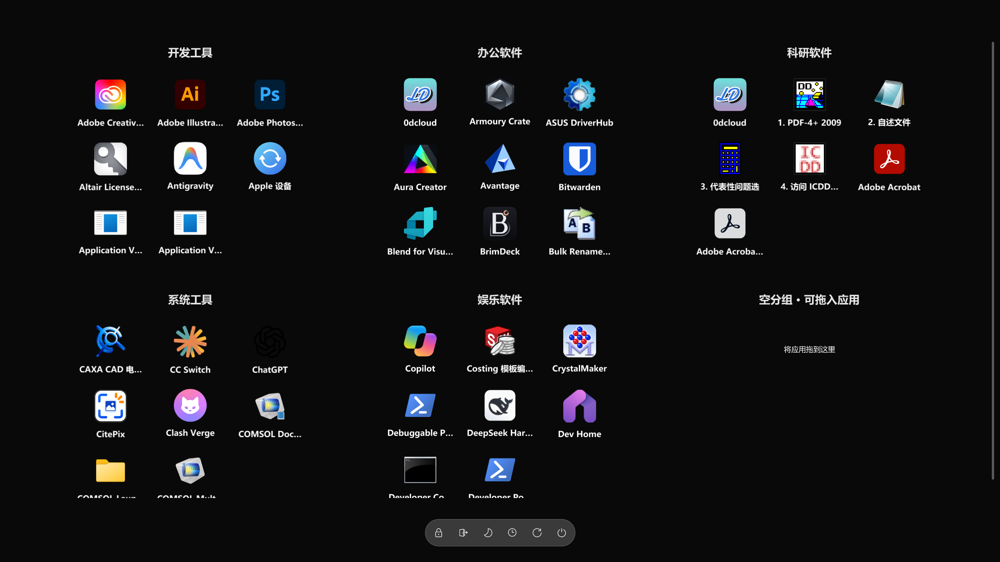

# 流光启动台

> 项目英文标识：Lumiflow（用于英文界面、GitHub 仓库与程序文件）

由 **Fangyu Guo (ryjs)** 维护的 Windows 11 / Windhawk 全屏应用启动器。当前版本 **1.5.10**。

这是一个**衍生作品**，不是从零重写：直接基础是 [DavidHiFi 的 Seamless Launchpad](https://github.com/DavidHiFi/davids-windhawk-mods/tree/main/mods/local/seamless-launchpad)，其更早来源为 [Rafael Mendes 的 Fullscreen Start (Launchpad style)](https://windhawk.net/mods/fullscreen-start)。三方均为 MIT 许可，原始版权与后续修改的版权分别保留，详见 [LICENSE](LICENSE) 与 [release/SOURCE_PROVENANCE.md](release/SOURCE_PROVENANCE.md)。



这个仓库仅包含启动器源码、构建工具和发布资料，不包含个人桌面布局、Windhawk 用户配置或旧开发仓库历史。上游源码快照放在 `reference/upstream/`，仅用于来源核对。

## 构建与安装

需要 Windows x64、Windhawk 编译器及 Python（`pip install -r dev/requirements.txt`）。

```powershell
powershell -NoProfile -ExecutionPolicy Bypass -File dev/Build.ps1 -Verify -Smoke
```

Windhawk 中新建模组，使用根目录的 `ryjs-launchpad.wh.cpp` 编译。开发源文件在 `mods/local/ryjs-launchpad/`；修改后执行上述命令重新生成单文件。内部 mod ID 仍为 `ryjs-launchpad`，以保证 Windhawk 存储和旧版设置继续可用；界面显示名按语言分别使用 Lumiflow（英文）与流光启动台（中文），不会在同一界面混用。不要同时启用旧版启动器与流光启动台来接管开始菜单。

本仓库是 Windhawk 单文件模组，没有独立安装程序、卸载程序或安装包；实际运行由 Windhawk 注入 Explorer。`dev/Build.ps1` 会生成开发预览程序 `build\Lumiflow.exe`，它只用于离屏和交互预览，不是可安装的产品 EXE。若后续制作独立发行版，可执行文件名使用 `Lumiflow.exe`。

## 数据兼容

新 ID 为 `ryjs-launchpad`，首次启动会复制旧 Custom 的整个存储目录（布局、分组、固定项、图标、旧 `ui-settings.ini` 等，跳过 `.tmp` 与 `performance*`）到独立存储 `local@ryjs-launchpad/data-v1`；实际只使用其中的布局、分组、固定项和图标，旧设置文件以 `migration-original-ui-settings.ini` 留档而不应用，因此无需读取 Windhawk 的注册表内部布局，便携版同样可用，旧存储也不会被修改或删除。已有数据不会被重新导入。旧目录无法通过校验时，以空布局正常启动并在新目录写入 `migration-note.txt` 说明原因，不再永久停留在只读状态；已存在的数据损坏或版本未知时仍以只读方式打开并提示，不以默认布局覆盖。品牌显示名变更后，这个内部 ID 和存储路径保持不变。

启动器“…”菜单提供“完整备份…”和“导入完整备份…”，使用 Windows 自带组件，无需安装 Python。备份为 `.ryjs.zip`，包括所有布局、分组尺寸、入口名称与启动参数、图标缓存和自定义图标、以及经 Windhawk API 读取的设置。不再包含安装源码、DLL 或注册表导出，因此便携版 Windhawk 也能完整备份。也兼容此前旧版工具生成的 `.ryjs.zip`（旧包中的源码、DLL 与注册表文件只会被忽略）。

导入时先校验清单、哈希、文件路径和数据版本，再显示确认提示；不执行或安装备份内的源码、DLL 或注册表文件。入口目标及启动参数会随入口恢复，确认提示会逐项列出这些目标和参数；开始按钮、Win 键 / Shift+Win 键的动作及“运行程序”命令始终保留本机当前值，不接受备份覆盖。确认后暂时关闭启动器，完成后重新载入。替换前的数据保留在 `data-v1.before-import-*` 同级目录，提交失败时回退。原 ZIP 保持不变。原有单个布局 TXT 导入/导出仍保留。

设置有两个入口：启动器内置设置窗口（“…”按钮）和 Windhawk 设置页。内置窗口保存的值优先于 Windhawk 设置页；之后在 Windhawk 设置页再次修改同一项时，该项以 Windhawk 的值为准。Windhawk 设置页不会自动刷新内置窗口保存的值。同一项请只用一个入口修改。

临时文件（`Export-StartLayout` 输出、完整备份工作目录、商店应用提权用的临时快捷方式）都位于存储目录相邻的 `tmp` 子目录，完成后删除；不再写入 `%TEMP%` 或用户配置目录。

存储目录存在但校验失败（损坏文件、未知版本）时，启动器以只读方式打开并保留原文件，不再拒绝加载；首次迁移被中断留下的 `data-v1.pending` 会先清理再重试。空的白名单布局（例如取消固定最后一个应用）视为有效空列表。

可选命令行工具为 `dev/layout_backup.py`。开发和测试使用隔离夹具，不备份或改写实际桌面布局。

## 验证与开发

`dev/README.md` 说明隔离预览；`dev/Test-Phase1.ps1` 验证存储兼容及输入处理。官方元数据和编译检查使用 `dev/Check-Library.ps1`。构建测试与实际任务栏、多显示器效果分别验收，不把离屏测试视为实机验证。

每次交付用户可见的更新时，递增 `ryjs-project.json` 中的版本号，同步更新日志，并重新生成 Windhawk 单文件与预览版本信息。版本历史见 [CHANGELOG.md](CHANGELOG.md)，来源与许可见 [release/SOURCE_PROVENANCE.md](release/SOURCE_PROVENANCE.md)。

## 操作

- 在设置的「电源」页，用每行的上下箭头调整电源按钮的左右顺序，也可选中一行后按 Ctrl+↑/↓。保存后生效，暂时隐藏的操作会保留排序位置。
- 点击搜索栏“…”→“添加入口”：浏览 `.exe`、`.lnk`、`.url`、`.rdp` 文件，或填写 HTTP/HTTPS 网址；也可选择商店应用。填写显示名、参数、工作目录及可选图标，并选择目标分组。
- 右键应用→“重命名”：仅修改启动台显示名称，Enter 确认、Esc 取消；“恢复原始名称”撤销名称覆盖。所有支持的应用类型均可使用，搜索同时匹配原名和自定义名。鼠标停留可查看完整名称。
- 右键应用→“编辑入口”：修改名称、路径或图标。重新扫描保留修改；原名称仍可搜索。路径失效时入口保留并显示标记，可以再次编辑修复。手动入口可单独删除，不删除目标文件。
- 网页入口异步读取目标站点声明的图标，并尝试 `/favicon.ico`，支持 ICO、PNG 和 Windows Direct2D 支持的 SVG。图标下载后保存在 `data-v1/web-icons`。获取失败时显示地球占位图，可右键刷新或手动换图。
- **联网边界**：默认在每次应用列表加载后为缺少缓存的网站入口后台获取图标，包括 Explorer 启动后的首次加载，不需要先打开启动台；范围也包括桌面和 Public Desktop 上符合条件的 `.url` 及浏览器 URL 快捷方式。保存入口和手动刷新也会下载。内置设置窗口「应用布局」页「网站图标」分组中的「后台下载网站图标」（Windhawk 设置页也有同名选项）可关闭应用列表加载后的自动请求，缓存仍可使用，保存/手动刷新仍可下载。请求会访问用户 URL、站点声明的图标地址（可能位于 CDN、第三方或内网主机）及 `/favicon.ico`，有超时和大小限制，不带 Cookie 或自动凭据，不上传数据；自定义图标不会触发该入口的网站请求。
- 手选图标以 PNG 保存在 `data-v1/custom-icons`。旧图标的原文件仍可读取时会自动迁移，迁移完成后可以删除原文件。
- “导出当前布局文件”默认提供“布局、图标和设置 (ZIP)”，包含所有来源的布局、自定义入口、已缓存的网页图标和手选图标。可从“导入布局文件”或“导入完整备份”恢复 ZIP。需要单独导出当前来源的排列时，可选 TXT。
- 多选应用后按 Enter 可打开所有选中项，也可点击多选工具栏上的打开按钮。
- “…”或分组标题右键→“编辑分组布局”：拖标题移动，拖右下角调整宽高。位置连续自由移动，尺寸按完整图标节距吸附到整数行列；标题和内边距单独计算。红色预览表示重叠，松手保持原位，不移动其他分组。Enter/“保存并完成编辑”统一写盘；Esc 取消当前拖动，再按一次取消整次编辑。关闭启动台也取消未保存编辑。
- 分组有多页时，鼠标移到组内滚一格即可翻页。底部短条显示当前位置。按住 Shift 滚动整体画布。分组标题右键可切换常驻分组与传统文件夹。所有切换、拖动都由用户主动触发，未编辑时保持旧布局。
- 设置→“应用布局”调整打开、关闭及文件夹动画时长；“外观”选择浅色、深色、跟随系统或自定义，并调整背景材质（可调模糊/饱和度/亮度/对比度/着色/明度雾/颗粒/压暗，或云母、系统亚克力、纯色、透明）、模糊半径与不透明度；材质页提供实时预览、内置预设以及用户预设的保存、导出和导入。

新布局几何保存于独立 `group-geometry-layout-*.txt`，入口属性保存于 `entries-v1.txt`。原分组成员和序位文件继续兼容。显示名称单独保存于 `display-names-v1.txt`。几何 schema 2 额外存储整数行列，兼容 schema 1；旧分组未主动拉伸时保留原有尺寸，首次转换前保留 `.before-v2.bak`。新发现的应用只出现在搜索中，须主动添加/固定才进入现有布局。

## 当前验证边界

已通过预览及 Windhawk x64 编译、官方元数据校验、隔离回归和离屏渲染。没有自动切换实际运行的 Windhawk 模组、打开真实远程连接或修改桌面布局。需实际确认 StartAllBack 点击状态、混合刷新率显示器、网站网络访问及启动参数对应程序的真实行为。

文字直接绘制在毛玻璃上，只使用纯黑或纯白；按文字实际占用区域采样同一张无文字 GPU 模糊图，叠加 tint、背景调暗及分组面板，sRGB 线性化后比较亮度，并用滞回稳定颜色。每次打开只读取一次背景，不逐帧截屏。默认自定义模糊模式与当前背景绘制同源；DWM 亚克力/系统模糊的最终材质不在本模块 GPU 位图内，使用打开前的屏幕模糊估计，不能视为最终合成像素检测。开关动画的透明度和时序保持原实现。

原生 Windows 11 开始按钮使用 XAML `ExperienceToggleButton`。流光启动台在其 WinRT 可见状态设置入口中，仅对 AutomationId 为 `StartButton` 且当前由流光启动台接管的状态阻止错误的“原生开始菜单可见”值。原生开始菜单操作仍透传；不改任务栏插件尺寸、样式或悬停反馈。该路径需要本机真实点击验证，模拟 Win32 按钮测试不代表 XAML 验收通过。
